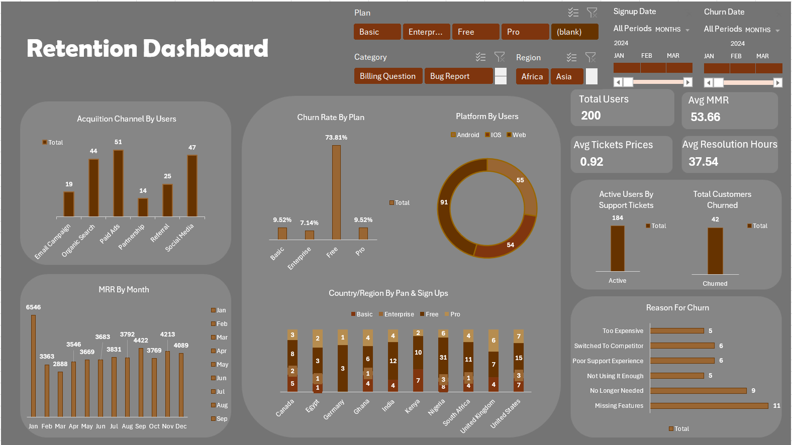

# Product analytics: retention and revenue (Excel)

A product analytics project built in Excel with Power Query and Power Pivot, turning raw subscription data into an interactive retention dashboard.

**Tools:** Excel · Power Query · Power Pivot · PivotTables · PowerPoint

## The question

How healthy is the subscription business? Specifically: how does churn vary by plan, which acquisition channels bring in the highest-value users, why do people leave, and do users who churn behave differently before they go?

## Approach

1. **Export and review** — exported the dataset as CSV and reviewed table structure, field coverage and data-quality problems before changing anything.
2. **Clean and prepare** — Power Query: promoted headers, unpivoted the calendar table, applied Trim and consistent capitalisation, corrected data types (including discount values to decimals) and fixed locale settings that were breaking dates.
3. **Build the data model** — Power Pivot diagram view, one-to-many relationships from Users to Support, Sessions, Churn and Billing; Channels joined to Churn on Churn ID rather than directly to Users, to keep each table at its own level of detail.
4. **Calendar table** — YEAR, MONTH, DAY and TEXT functions to support month grouping and date filters.
5. **KPIs and measures** — Total Users, Average MRR, Average Ticket Price, Average Resolution Hours.
6. **Analysis** — PivotTables comparing plans, channels, regions, platforms and customer groups.
7. **Dashboard** — KPI cards and charts on a consistent colour scheme, with slicers for Plan, Category and Region and timelines for sign-up and churn dates.
8. **Presentation** — a stakeholder deck covering the questions, the approach, the findings and why they matter.

## Business questions investigated

- What is the overall churn rate, and how does it vary by subscription plan?
- What was total MRR in December 2025, and which acquisition channel brings the highest-value users?
- What is the most common reason users give for churning?
- Do users who churn raise more support tickets than retained users before they leave?
- Which platform — Web, iOS or Android — has the most engaged users?
- Which country or region generates the most sign-ups, and which plans are most popular there?

## Outputs

- Cleaned and consistently formatted datasets
- A connected Excel data model with a calendar table for time-based reporting
- KPIs and PivotTables answering the questions above
- An interactive dashboard with slicers and date timelines
- A PowerPoint presentation of the analysis and key findings

## Skills demonstrated

Data preparation and cleaning in Power Query · data modelling and one-to-many relationships in Power Pivot · working with multiple related CSV datasets · date and text functions · KPI and PivotTable design · slicers and timelines for interactive reporting · dashboard design and presenting insight to stakeholders.
## Files in this repository

| File | What it is |
| --- | --- |
| `retention-dashboard.png` | The finished dashboard |
| `product-analysis-power-query.xlsx` | The working file: Power Query steps, data model, PivotTables and dashboard |
| `product-raw-data.xlsx` | The raw dataset before cleaning |
| `retention-dashboard-report.pptx` | The stakeholder presentation |
| `project-workflow.docx` | The full project workflow write-up |

---

By [Chantelle Quarshie](https://chantelle-quarshie.github.io/) — Data Analyst & Data Visualisation Professional, London.
